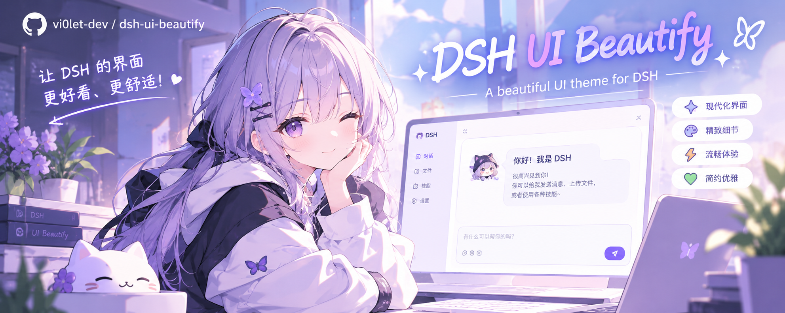

<p align="center">
  
</p>

# dsh-ui-beautify

给 DeepSeek Harness（DSH）Web 界面加一层可配置的外观层：**风格预设、表面透明度、背景图、界面/代码字体**。

它只通过 DSH 官方 Client `theme` 服务的 `overrideTokens` 覆盖设计令牌，并用插件自己的 `<style>` 绘制背景图；不替换 app root、不追加第二个应用、不联网、不读会话内容。

> 状态：源码已完成，28 项单元测试、结构自检与安全扫描通过；**尚未在你的 DSH 中安装、启用或做视觉验证**。安装与验收由你自行完成。
>
> 仓库：<https://github.com/vi0let-dev/dsh-ui-beautify>
>
> 版本：`0.1.2` —— 设置页固定 100% 不透明，表面透明度只影响设置页之外的界面；`0.1.1` 起背景图改为 IndexedDB Blob 存储（原文件上限 40 MB，解除 localStorage 字符上限）。

---

## 功能

| 功能 | 说明 |
|---|---|
| 风格预设 | 跟随 DSH / 玻璃 / 暖纸 / 樱花 / 极简；每套都定义明亮与深色两组取值 |
| 表面透明度 | 0–100%，作用于主背景、卡片、侧栏、气泡、代码块等表面 |
| 设置页不透明 | 无论表面透明度调到多少，设置面板始终 100% 不透明，方便边调边看 |
| 背景图 | 本地上传（浏览器内压缩后保存）或 http(s) 图片链接；支持 0–24px 模糊、0–70% 遮罩 |
| 界面字体 | 跟随 DSH / 系统无衬线 / 衬线（宋体）/ 圆体 / 等宽 / 自定义字体列表 |
| 代码字体 | 跟随 DSH / 等宽 / 系统无衬线 / 自定义字体列表 |
| 圆角风格 | 随预设改变 `--dsw-radius-*`；不改 DSH 的语义状态色 |
| 恢复默认 | 两次点击确认后恢复“跟随 DSH + 不透明 + 无背景图 + 跟随字体” |

设置入口：**侧边栏 → 设置 → 界面美化**。所有修改即时生效。

---

## 环境要求

- DSH `>=0.2.1-rc.2 <0.3.0`（见 `package.json` 的 `engines.dsh`）
- Node.js `^22.19.0 || >=24.0.0`
- 仅适用于 Web 界面（`dsh.client.platform = "web"`）

插件没有运行时依赖；`react` 由 DSH 浏览器模块表提供，不额外打包第二份 React。

契约按 DSH `0.2.1-rc.2` 核对，使用的扩展点：

| 扩展点 | 用途 |
|---|---|
| Client `ctx.theme.overrideTokens(source, tokens)` | 以 `{ light, dark }` 双套值覆盖设计令牌，卸载时移除该层 |
| `settings.section` | “界面美化”整页设置 |
| `ctx.locale` | 设置页与插件管理器文案 |
| `<style data-plugin data-plugin-css>` | 背景图与设置页样式，卸载时移除 |

---

## 安装

> 以下命令需要你自己执行：本仓库不包含安装脚本，也不会自动修改你的 profile。

GitHub 仓库（公开）：<https://github.com/vi0let-dev/dsh-ui-beautify>

**方式一：插件页安装（推荐）**

1. 侧边栏 → **插件** → **添加插件**
2. 输入 `github:vi0let-dev/dsh-ui-beautify`
3. 按提示启用，完全退出 DSH 并重启，然后硬刷新页面（Windows/Linux `Ctrl+F5`，macOS `Cmd+Shift+R`）
4. 侧边栏 → **设置**，左侧出现 **界面美化**，即安装成功

**方式二：GitHub 命令行安装**

```powershell
# 先确认自己的 profile 名，不要照抄
$env:DSH_PROFILE

dsh plugin --profile <profile> add github:vi0let-dev/dsh-ui-beautify
```

锁定到本次发布的 tag：

```powershell
dsh plugin --profile <profile> add "github:vi0let-dev/dsh-ui-beautify#v0.1.2"
```

当前分支为 `main`。插件页/命令行安装的是仓库默认分支 `main` 的最新提交；仓库更新后需要重新执行一次 `dsh plugin ... add` 才会拉取新版本。

本地开发调试：

```powershell
dsh plugin --profile <profile> add "<项目绝对路径>"
```

> 本地目录是链接安装，**不要移动或删除原目录**，否则插件随之失效。

**升级**：GitHub 直装会在 profile 里放一份副本。升级到 `0.1.2`（设置页固定不透明）时，重新执行一次 `dsh plugin --profile <profile> add github:vi0let-dev/dsh-ui-beautify`（或锁定 `#v0.1.2`），完全退出 DSH 并重启，然后硬刷新页面；本地链接安装改完刷新页面即可。

**卸载 / 恢复原始外观**：在插件页停用并卸载，重启 DSH 后刷新页面。插件卸载时会移除 token 图层、背景图样式、根节点属性和 CSS 变量；浏览器 localStorage 里的两个键需要手动清除（见下方「配置」）。

---

## 使用

1. 打开 **设置 → 界面美化**。设置面板始终 100% 不透明，透明度滑块只改变面板之外的界面。
2. 在「外观风格」里选一套预设，或保持“跟随 DSH”。
3. 需要背景图时：选择本地图片，或粘贴 http(s) 图片链接后点「使用链接」。
4. 调「表面透明度」让背景图透出；文字不清楚时调高「背景遮罩」或降低「背景模糊」。
5. 在「字体」里选择界面字体/代码字体；选「自定义…」后输入逗号分隔的字体名。

典型组合：

- **玻璃 + 背景图 + 60% 透明度 + 20% 遮罩**：半透明磨砂感，背景图可见且文字可读。
- **暖纸 + 不透明 + 衬线字体**：接近纸张的阅读界面。
- **极简 + 不透明 + 等宽字体**：低装饰、高信息密度。

---

## 配置

没有 Host 配置项，`cordis.patch.yml` 的 `config` 保持空对象。所有偏好保存在浏览器：

| 存放位置 | 内容 | 清理方式 |
|---|---|---|
| IndexedDB `dsh-ui-beautify` → store `wallpaper` | 背景图 Blob + 名称/尺寸/字节数（优先使用） | 设置页「清除背景图」，或 DevTools → Application → IndexedDB 删除 `dsh-ui-beautify` |
| `localStorage['dsh-ui-beautify:settings']` | 风格、透明度、模糊、遮罩、字体选择（JSON） | 设置页「恢复默认」，或控制台 `localStorage.removeItem('dsh-ui-beautify:settings')` |
| `localStorage['dsh-ui-beautify:wallpaper']` | 旧版/回退：背景图 data URL 或图片链接（仅当 IndexedDB 不可用时使用） | 设置页「清除背景图」，或控制台 `localStorage.removeItem('dsh-ui-beautify:wallpaper')` |

默认值：

| 字段 | 默认值 | 范围 |
|---|---|---|
| `style` | `follow` | `follow` / `glass` / `paper` / `sakura` / `minimal` |
| `surfaceOpacity` | `100` | 0–100 |
| `wallpaperBlur` | `0` | 0–24 |
| `wallpaperDim` | `0` | 0–70 |
| `fontText` | `follow` | `follow` / `sans` / `serif` / `rounded` / `mono` / `custom` |
| `fontCode` | `follow` | `follow` / `mono` / `sans` / `custom` |

- 非法/越界值在读取时回落到默认值。
- 本地背景图优先存到 IndexedDB（Blob），因此不再受 localStorage 的字符上限限制。原文件最大 40 MB；最长边超过 2560px 或原文件超过 8 MB 时，会先缩到最长边 2560px 并按质量阶梯压成 WebP，压缩结果上限 12 MB。
- IndexedDB 不可用时回退到 localStorage data URL，此时仍受约 180 万字符上限，并在存储配额不足时提示「仅本次会话生效」。
- 浏览器存储不可用或配额不足时，设置仍会在本次会话生效，但刷新后丢失。

---

## 项目结构

```text
dsh-ui-beautify/
├── package.json          # bundle 声明：dsh.bundle.patch + dsh.client
├── cordis.patch.yml      # 把插件插入 profile 组合树
├── index.js              # Host 半边：空实现（本插件没有 Host 逻辑）
├── client.js             # 全部实现：token 图层、背景图、字体、设置页
├── locale/{zh,en}.json   # 插件管理器显示的标题与描述
├── icon.svg              # 插件图标
├── docs/banner.png       # README 顶部 banner
├── test/client.test.mjs  # node:test + node:vm 行为测试
├── AUDIT.md              # 代码审计与隐私检查报告
├── README.md
├── LICENSE
├── .gitignore
└── .gitattributes
```

---

## 依赖

运行时零依赖。开发/测试只使用 Node 内置的 `node:test`、`node:vm`、`node:assert`、`node:fs`。

---

## 隐私说明

| 问题 | 回答 |
|---|---|
| 读取哪些数据 | 只读取你在设置页主动选择的本地图片；不读会话内容、文件系统或其他插件数据 |
| 数据发往哪里 | 插件 JavaScript 不发任何网络请求；若你填写远程图片链接，浏览器会按该地址请求图片 |
| 是否持久化 | 背景图 Blob 写入本机 IndexedDB `dsh-ui-beautify`；设置写入 localStorage `dsh-ui-beautify:settings`；IndexedDB 不可用时背景图回退到 localStorage `dsh-ui-beautify:wallpaper` |
| 是否采集遥测 | 无 |
| 如何清除数据 | 设置页「恢复默认」/「清除背景图」，或删除 IndexedDB 数据库 `dsh-ui-beautify` 与上述 localStorage 键 |

---

## 安全注意事项

- 不执行动态代码：没有 `eval`、`new Function`、`innerHTML`、`document.write`。
- 背景图只接受 `http(s)` 链接或 `data:image/(png|jpeg|webp|gif|avif);base64,...`；拒绝 `javascript:`、`file:`、SVG data URL、带用户名/密码的 URL。
- 不替换 DSH 的 app root，不向 `document.body` 追加第二个应用；背景图只画在 `body::before` / `body::after` 两个插件自有伪元素上。
- 所有注册（locale、slot、样式、token 图层、CSS 变量、订阅）都挂在 `ctx.effect` 上并返回清理函数。
- 透明度过低会降低可读性；菜单/弹出层保留至少 88% 不透明度。
- 远程图片由浏览器加载，受你的浏览器 CSP、代理与网络策略约束；插件无法验证远端图片是否可用。

---

## 开发说明

```powershell
node --check index.js
node --check client.js
node test/client.test.mjs      # 28 项测试，直接运行（无需 spawn 子进程）
```

也可以 `node --test test`，但在某些受限沙箱里跑测试 runner 会因 `spawn EPERM` 失败，直接执行测试文件即可。

测试覆盖：模块注册 id、依赖声明、`settings.section` 注册参数、locale 字典、设置归一化与越界回退、hex→rgba 换算、预设 token 明暗双套、透明度表面覆盖、设置面板不透明 token、字体预设与自定义、背景图 URL/data URL 安全校验、背景图 CSS 生成与转义、本地图片的 IndexedDB Blob 路径与 localStorage 回退路径、超尺寸缩放、损坏图片拒绝、apply/cleanup 行为、存储异常兜底、token 图层去重、设置页 CSS token 使用，以及“无网络 / 无 eval / 无 HTML 注入”的静态断言。

改造指引：

- 五套调色板集中在 `client.js` 的 `STYLES`，每套含 `palette.light` / `palette.dark` / `radius`。改值即改观感。
- 字体预设集中在 `FONT_TEXT_PRESETS` / `FONT_CODE_PRESETS`。
- 新增预设需要同时更新 `STYLE_IDS`（按钮、校验、token 构建都读它）与 `locale/{zh,en}.json` 的 `meta`（插件管理器显示）。
- token 名必须与当前 DSH 版本一致；升级 DSH 后先用主题 inspect 复核 `--dsw-alias-*` 与 `--dsh-font-family-*`。

---

## 已知限制

1. **尚未做真机视觉验证**：本仓库只做了静态核对与单元测试。`settings.section` 是否正常渲染、五个预设的实际观感、深色模式下的对比度，都需要你在真实 DSH 中确认。
2. **只覆盖已知/常用的设计令牌**：主背景、层、侧栏、气泡、代码块、边框、标签、品牌色与圆角。部分嵌套组件（菜单、对话框、第三方面板）可能保留自己的不透明表面。
3. **透明度需要背景图才明显**：没有背景图时，透明表面露出的是画布底色（白/深），观感变化较小。
4. **菜单/弹出层有 88% 不透明度下限**：避免为了透明而牺牲可读性，因此它们不会完全透明。
5. **背景图存储**：优先存 IndexedDB Blob（原文件上限 40 MB，压缩结果上限 12 MB）；IndexedDB 不可用时回退到 localStorage data URL，此时约 180 万字符上限，超限会提示改用图片链接。隐私模式或存储被禁用时，设置只在本次会话生效。
6. **远程图片受 CSP/网络影响**：插件只校验 URL 协议；图片能否加载由浏览器决定。
7. **第三方 DSH 主题**：透明表面与设置面板使用插件自带的明暗中性/预设色，不读取第三方主题的原始色值；换用第三方主题后，设置面板与透明表面的底色可能与主题不完全一致。
8. **字体覆盖优先于 DSH 字体设置**：选择非“跟随 DSH”的字体后，DSH 自带的字体设置会被本插件覆盖；想恢复 DSH 字体请选“跟随 DSH”。
9. **未做动效**：预设只改色彩、圆角与透明度，不做消息入场/悬停动画，避免依赖构建期哈希类名。
10. **macOS 窗口样式差异**：DSH 在 macOS 上让 AppFrame 透明、侧栏使用渐变；本插件按 Windows/Web 的令牌路径设计，macOS 上的透明表现可能不同。

---

## 许可证

MIT，见 [LICENSE](LICENSE)。
